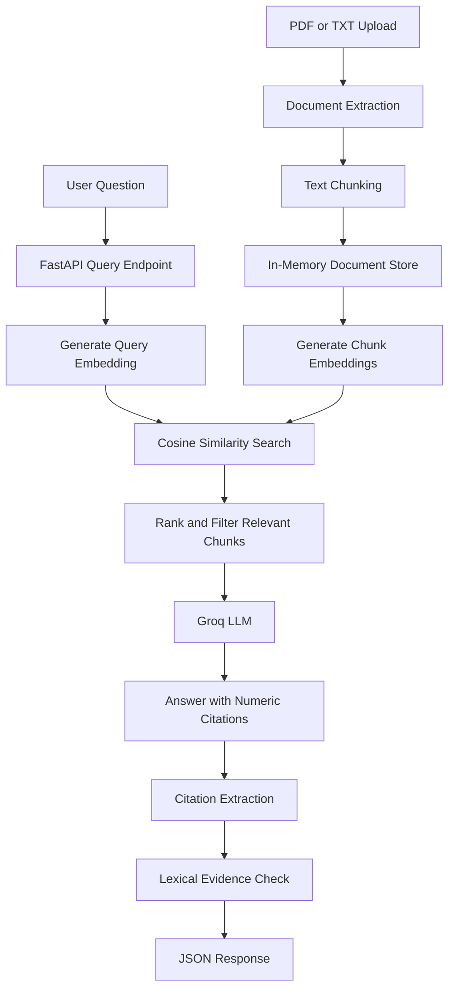

# RAG Citations Assistant

A Retrieval-Augmented Generation (RAG) application that answers questions about uploaded documents, retrieves relevant passages using semantic similarity, and returns source citations with a basic evidence-verification status.

Built with Python, FastAPI, Sentence Transformers, and Groq.

## Features

- **Document ingestion:** Upload PDF and TXT documents through a REST API.
- **Text chunking:** Split extracted document text into smaller passages for retrieval.
- **Semantic retrieval:** Use `sentence-transformers/all-MiniLM-L6-v2` to generate embeddings and rank relevant chunks by cosine similarity.
- **Grounded answer generation:** Use a Groq-hosted language model to generate answers from retrieved passages.
- **Source citations:** Return the source filename, page number, chunk ID, and citation reference.
- **Citation verification:** Apply a lexical heuristic to estimate whether cited source text supports the generated answer.
- **Input validation and error handling:** Validate query parameters and uploaded file types and sizes.
- **Automated testing:** Test API behavior, citation extraction, verification logic, and answer generation.

## Architecture



### How it works

1. A user uploads a PDF or text document.
2. The application extracts its text, splits it into chunks, and stores the chunks with source metadata.
3. When a question arrives, the application generates embeddings for the question and document chunks.
4. Cosine similarity ranks the chunks, and the most relevant passages are selected.
5. Groq generates an answer using the retrieved context and numeric citation references.
6. The application validates citation references and applies a lexical heuristic to assess possible source support.
7. The API returns the answer, retrieved passages, citation metadata, and verification statuses.

## Tech stack

| Technology | Purpose |
|---|---|
| Python | Application logic |
| FastAPI | REST API |
| Sentence Transformers | Text embeddings |
| all-MiniLM-L6-v2 | Embedding model |
| PyTorch | Model inference |
| Groq API | Language model inference |
| Pydantic | Request validation |
| pytest | Automated testing |
| Ruff | Code quality and linting |

## Project structure

```text
rag-citations-assistant/
├── src/
│   └── app/
│       ├── main.py
│       ├── embeddings.py
│       ├── search.py
│       ├── chunker.py
│       ├── document_loader.py
│       ├── store.py
│       ├── answer_generator.py
│       ├── citation_verifier.py
│       └── config.py
├── data/
│   └── machine_learning.txt
├── tests/
├── README.md
└── requirements.txt
```

## Getting started

### Prerequisites

- Python 3.13 or a compatible Python version
- A Groq API key
- Internet access to install dependencies and download the embedding model the first time

### 1. Clone the repository

```bash
git clone https://github.com/heeradeepsingh5252/rag-citations-assistant.git
cd rag-citations-assistant
```

### 2. Create a virtual environment

```bash
python3 -m venv .venv
source .venv/bin/activate
python -m pip install --upgrade pip
```

### 3. Install dependencies

```bash
python -m pip install -r requirements.txt
```

### 4. Configure environment variables

Create a `.env` file in the project root:

```env
GROQ_API_KEY=your_groq_api_key
GROQ_MODEL=openai/gpt-oss-120b
```

Replace `your_groq_api_key` with your own key. Never commit your actual API key or `.env` file to GitHub.

### 5. Download the embedding model

The application is configured to load the embedding model from the local Hugging Face cache. Download it once before starting the application:

```bash
python -c "from sentence_transformers import SentenceTransformer; SentenceTransformer('sentence-transformers/all-MiniLM-L6-v2')"
```

### 6. Start the API

```bash
PYTHONPATH=. .venv/bin/uvicorn src.app.main:app --reload
```

Open Swagger UI:

http://127.0.0.1:8000/docs

Check the health endpoint:

```bash
curl http://127.0.0.1:8000/health
```

## API usage

### Health check

`GET /health`

Returns the application's health status.

### Upload a document

`POST /documents/ingest`

Upload a PDF or TXT file using the multipart form in Swagger UI. The API returns document metadata and extracted chunks.

### Ask a question

`POST /documents/query`

Example request:

```json
{
  "question": "What is supervised learning?",
  "top_k": 3
}
```

The response includes:

- `answer`: generated response
- `result_count`: number of retrieved passages
- `results`: retrieved chunks and similarity scores
- `citations`: source filename, page, and chunk metadata
- `verification`: citation IDs, source metadata, verification statuses, and the verification method

## Testing and code quality

Run the automated test suite:

```bash
PYTHONPATH=. .venv/bin/pytest -q
```

Run Ruff:

```bash
PYTHONPATH=. .venv/bin/ruff check src tests
```

Run the Git whitespace check:

```bash
git diff --check
```

**Latest verified results during development:**

- 32 automated tests passed.
- Ruff reported no issues.
- The live API successfully ingested a document, retrieved relevant passages, generated an answer, and returned citation-verification metadata.

These are functional checks, not a formal benchmark of retrieval accuracy or answer faithfulness.

## Design decisions and trade-offs
