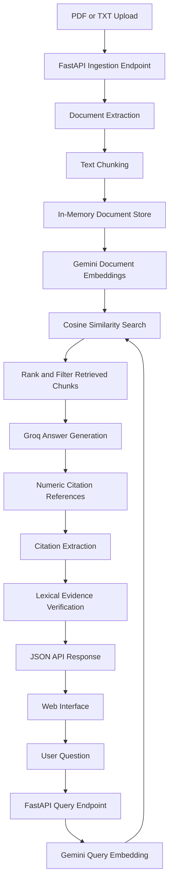

# RAG Citations Assistant

A Retrieval-Augmented Generation (RAG) application that answers questions about uploaded documents, retrieves relevant passages using semantic similarity, and returns source citations with a lightweight evidence-verification status.

Built with Python, FastAPI, Google Gemini Embedding API, and Groq. Deployed on Render with a custom web interface for document upload, question answering, and source inspection.

## Live Demo

- **Live web application:** https://rag-citations-assistant.onrender.com/
- **Interactive API documentation:** https://rag-citations-assistant.onrender.com/docs
- **Health check:** https://rag-citations-assistant.onrender.com/health
- **Source code:** https://github.com/heeradeepsingh5252/rag-citations-assistant

The free hosting tier may take longer to respond after inactivity. The sample document is preloaded at startup when the in-memory store is empty. Uploaded documents are stored in memory and may need to be uploaded again after a server restart.

## Features

- **Document ingestion:** Upload PDF and TXT documents through the web interface or REST API.
- **Text chunking:** Extract document text, split it into smaller passages, and preserve source metadata.
- **Semantic retrieval:** Use Gemini embeddings and cosine similarity to rank relevant passages for a question.
- **Grounded answer generation:** Use a Groq-hosted language model to generate answers from retrieved context.
- **Source citations:** Return numeric citation references with source filename, page number, and chunk metadata.
- **Evidence verification:** Apply a lexical heuristic to estimate whether cited source text supports the answer.
- **Interactive web interface:** Upload documents, ask questions, view answers, and inspect retrieved passages and similarity scores.
- **Input validation:** Validate query parameters, uploaded file types, and file sizes.
- **Automated testing:** Test API behavior, embedding integration points, citation extraction, verification logic, and answer generation.

## Architecture



### How it works

1. A user uploads a PDF or text document through the web interface or API.
2. FastAPI extracts the text, splits it into chunks, and stores the chunks with source metadata.
3. When a question arrives, the application generates a Gemini query embedding and reuses cached document embeddings for identical chunk-text batches when available.
4. The application compares normalized vectors using cosine similarity and selects the most relevant passages.
5. Groq generates an answer using the retrieved passages and numeric citation references.
6. The application extracts valid citations and applies a lexical heuristic to estimate source support.
7. The API returns the answer, retrieved passages, similarity scores, citation metadata, and verification results.
8. The web interface displays the answer and its supporting source passages.

## Tech Stack

| Technology | Purpose |
|---|---|
| Python | Application logic |
| FastAPI | REST API and backend |
| Google Gemini Embedding API | Document and query embeddings |
| Google Gen AI SDK | Gemini integration |
| Groq API | Language model inference |
| Pydantic | Request validation |
| pypdf | PDF text extraction |
| HTML, CSS, JavaScript | Web interface |
| pytest | Automated testing |
| Ruff | Code quality and linting |
| Render | Cloud hosting and deployment |
| Git and GitHub | Version control and source hosting |

## Project Structure

```text
rag-citations-assistant/
├── src/
│   └── app/
│       ├── main.py
│       ├── embeddings.py
│       ├── search.py
│       ├── chunker.py
│       ├── document_loader.py
│       ├── store.py
│       ├── answer_generator.py
│       ├── citation_verifier.py
│       └── config.py
├── static/
│   └── index.html
├── data/
│   └── machine_learning.txt
├── tests/
├── README.md
└── requirements.txt
```

## Getting Started

### Prerequisites

- Python 3.13 or a compatible Python version
- A Google Gemini API key
- A Groq API key
- Git
- Internet access for API requests and dependency installation

### 1. Clone the repository

```bash
git clone https://github.com/heeradeepsingh5252/rag-citations-assistant.git
cd rag-citations-assistant
```

### 2. Create and activate a virtual environment

On macOS or Linux:

```bash
python3 -m venv .venv
source .venv/bin/activate
python -m pip install --upgrade pip
```

### 3. Install dependencies

```bash
python -m pip install -r requirements.txt
```

### 4. Configure environment variables

Create a `.env` file in the project root:

```env
GEMINI_API_KEY=your_gemini_api_key
GROQ_API_KEY=your_groq_api_key
GROQ_MODEL=openai/gpt-oss-120b
```

Replace the placeholders with your own API keys.

**Security:** Never commit your actual API keys or `.env` file to GitHub. Configure production secrets through your hosting provider's environment-variable settings.

### 5. Start the application locally

```bash
PYTHONPATH=. python -m uvicorn src.app.main:app --reload --port 8000
```

Open the web interface:

http://127.0.0.1:8000/

Open the interactive API documentation:

http://127.0.0.1:8000/docs

Check the health endpoint:

```bash
curl http://127.0.0.1:8000/health
```

## API Usage

### Health Check

`GET /health`

Returns the application's health status.

### Upload a Document

`POST /documents/ingest`

Upload a PDF or TXT file using the web interface or Swagger UI.

Example using cURL:

```bash
curl -X POST \
  http://127.0.0.1:8000/documents/ingest \
  -F "file=@data/machine_learning.txt"
```

The response includes the filename, extracted pages, and generated chunks.

### Ask a Question

`POST /documents/query`

Example request:

```json
{
  "question": "What is supervised learning?",
  "top_k": 3
}
```

Example using cURL:

```bash
curl -X POST \
  http://127.0.0.1:8000/documents/query \
  -H "Content-Type: application/json" \
  -d '{
    "question": "What is supervised learning?",
    "top_k": 3
  }'
```

The response includes:

- `question`: the submitted question
- `answer`: the generated answer
- `result_count`: number of retrieved passages
- `results`: retrieved chunks and similarity scores
- `citations`: source filename, page number, chunk ID, and citation reference
- `verification`: citation IDs, source metadata, verification statuses, and the verification method

## Testing and Code Quality

Run the automated test suite:

```bash
PYTHONPATH=. .venv/bin/pytest -q
```

Run Ruff:

```bash
PYTHONPATH=. .venv/bin/ruff check src tests
```

Check Git changes for whitespace errors:

```bash
git diff --check
```

### Retrieval Evaluation

Run the sample-document retrieval benchmark:

```bash
PYTHONPATH=. .venv/bin/python evaluation/evaluate_retrieval.py
```

The script makes Gemini embedding API requests. Review API usage before running it repeatedly.

### Verified Development Results

- **36 automated tests passed** in the latest local test run.
- Ruff reported no issues in the latest reported lint check.
- The live deployment successfully ingested a sample document, retrieved relevant passages, generated an answer, and returned citation-verification metadata.
- The public web interface successfully completed an upload and question-answering workflow.

The retrieval evaluation also passed 5/5 evidence-retrieval checks and 10/10 out-of-scope rejection checks on the current 15-question, single-document benchmark using a 0.65 similarity threshold. These results describe this small benchmark only and do not establish general retrieval accuracy or answer faithfulness.

## Design Decisions and Trade-offs

### Hosted Embeddings

The application uses the Gemini Embedding API rather than loading a local embedding model. This reduces the memory needed by the hosting service and avoids loading a local PyTorch model at runtime.

The trade-off is dependence on network connectivity, API availability, usage limits, and provider latency.

### Semantic Similarity Retrieval

Document and query embeddings are normalized before similarity scoring. This makes dot-product similarity equivalent to cosine similarity for the normalized vectors.

The application generates document-chunk embeddings through Gemini and caches identical text batches in process memory using an LRU cache of up to 16 batches. This reduces repeated embedding requests for unchanged batches. The cache resets when the process restarts and is not a persistent vector index. Larger collections would benefit from a persistent vector store and durable chunk-level embeddings.

### In-Memory Document Storage

Chunks are stored in memory rather than a persistent database. This keeps the implementation simple but means uploaded documents can be lost after a process restart or service restart.

### Grounded Answer Generation

Groq generates answers using the retrieved document passages. The prompt directs the model to stay within the provided context and attach numeric citations to factual claims.

A prompt cannot guarantee that every generated statement is supported, so the citations and answers still require evaluation.

### Lightweight Citation Verification

The verifier uses lexical overlap and simple negation checks to estimate whether an answer is supported by its cited passage.

A result of `possible_support` means the text passed the current heuristic. It is **not proof of semantic entailment or factual correctness**.

## Limitations and Future Improvements

- **Persistent storage:** Replace in-memory storage with a persistent vector database.
- **Embedding reuse:** Generate and cache document embeddings during ingestion.
- **Retrieval quality:** Evaluate alternative chunking strategies, hybrid search, and reranking.
- **Verification quality:** Implement stronger claim-level semantic verification and contradiction detection.
- **Formal evaluation:** Measure retrieval with Precision@k, Recall@k, and MRR on a labeled dataset. Evaluate answer faithfulness and citation correctness against reviewed examples.
- **Production reliability:** Add structured logging, monitoring, rate limiting, and robust API error handling.
- **Security:** Add authentication and appropriate controls if the application is opened to unrestricted public use.
- **Frontend improvements:** Add document management, richer citation navigation, and clearer error states.

## Author

**Heeradeep Singh**

- GitHub: https://github.com/heeradeepsingh5252
- Project: https://github.com/heeradeepsingh5252/rag-citations-assistant
- Live demo: https://rag-citations-assistant.onrender.com/
